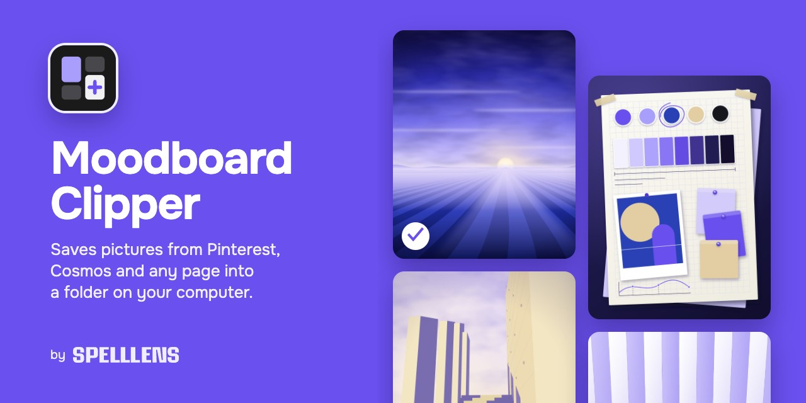
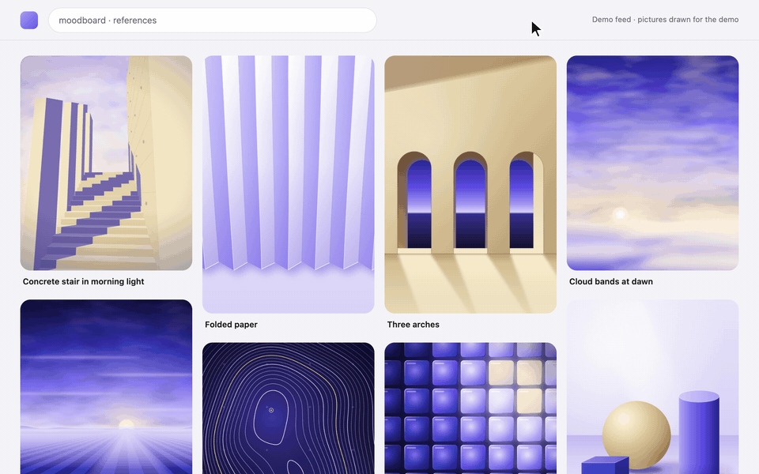
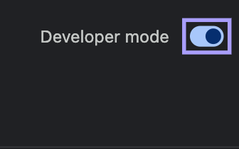
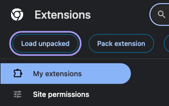
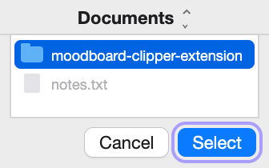
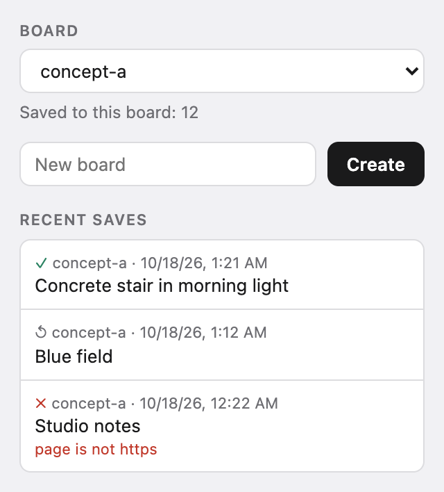

# Moodboard Clipper

An extension for Chrome and other Chromium browsers. It saves pictures from Pinterest, Cosmos and any web page into a folder on your computer: a folder per board, and next to each picture a card with the page it came from, the author when the page shows one, and the time.

**[Download](https://github.com/georgespelllens/moodboard-clipper/releases/latest/download/moodboard-clipper-extension.zip)** · [How to install](#install) · [Site](https://spelllens.ru/moodboard-clipper/) · [Русский](README.ru.md)

## Install

The same on Mac, Windows and Linux.

1. Download [`moodboard-clipper-extension.zip`](https://github.com/georgespelllens/moodboard-clipper/releases/latest/download/moodboard-clipper-extension.zip) and unzip it: double-click it on a Mac; on Windows, right-click it and choose **Extract All**.
2. Move the `moodboard-clipper-extension` folder to where it will stay, for example Documents. The browser loads the extension from this folder every time it starts, so don't delete or rename it.
3. Open `chrome://extensions` (Yandex Browser: `browser://extensions`) and turn on **Developer mode**. Paste the address into the address bar: pages like this don't open from links.
4. Click **Load unpacked**.
5. Choose the `moodboard-clipper-extension` folder.

| 3. Turn on Developer mode | 4. Click Load unpacked | 5. Choose the folder |
|---|---|---|
|  |  |  |

The Moodboard Clipper card appears. Pin the extension's icon to the toolbar to pick boards.

To check the download, put [`SHA256SUMS.txt`](https://github.com/georgespelllens/moodboard-clipper/releases/latest/download/SHA256SUMS.txt) next to the zip and run `shasum -a 256 -c SHA256SUMS.txt` in that folder on a Mac, or `sha256sum -c SHA256SUMS.txt` on Linux. On Windows, open PowerShell in the folder with the zip (in File Explorer, type `powershell` in the address bar and press Enter), run `(Get-FileHash moodboard-clipper-extension.zip).Hash.ToLower()` and compare the result with the zip's line in `SHA256SUMS.txt`.

Other browsers, Linux, updating and removing: [docs/INSTALL.md](docs/INSTALL.md).

## How to use

- **Pinterest and Cosmos:** hover over a picture and click ＋ in its corner. When the picture is saved, ＋ turns into ✓. If it was already in this board, it is not downloaded again, and the tooltip on ✓ says so.
- **Any page:** right-click a picture → **Save to moodboard**. This works when a site lays a link over the picture, too.
- **Behance:** project pictures sit under an empty layer, so right-click the picture and use **Save to moodboard** from the page menu: it takes the picture under the cursor.
- **Boards:** click the extension icon to pick or create a board and see the last 10 saves. Without a choice pictures go to `unsorted`.

<picture>
  <source media="(prefers-color-scheme: dark)" srcset="site/assets/media/popup-en-dark.png">
  
</picture>

Files land in `Downloads/moodboard-inbox/<board>/`, or in [a folder of your own](#own-folder). From Pinterest and Cosmos you get the original size where the site serves it; otherwise the extension takes the largest copy it can reach, and the card says which. From other pages you get the picture as the page shows it. The card `<id>.json` names the page, the picture's address, the author when the page shows one, and the time. Its fields: [docs/FORMAT.md](docs/FORMAT.md).

## Own folder

By default the browser's downloads put the files into `Downloads/moodboard-inbox/<board>/`. To save into a folder of your own instead:

1. Click the extension icon. A line at the top of its window says where saves go; click **Own folder…**.
2. On the page that opens, click **Choose folder**, or drag a folder onto the page. Chrome does not let you pick the Downloads folder itself, so pick a folder inside it, for example `Downloads/moodboard-inbox`: the boards already there stay where they were.
3. Close that tab, open the extension's window again and click **Connect folder**.

Each board becomes a subfolder of the chosen folder, and the extension writes the picture and its card there itself. So the browser's **Ask where to save each file before downloading** no longer matters, and ordinary downloads keep asking as before.

After each browser start (and after you close the tab from step 2) the extension needs one more click on **Connect folder** in its window. Until then its icon shows `!` and saves end with "folder is not connected".

A picture from a site other than Pinterest, Cosmos and Behance (right-click → **Save to moodboard**) may need access to that site. The save then ends with ✗, and its row in the recent saves offers **Allow on all sites**: an optional permission that the browser asks for only on that click.

To go back to Downloads, click **Change** in the extension's window and then **Save to Downloads again** on the page that opens.

It works in Chromium browsers that have File System Access; connecting the folder with one click in the extension's window needs Chrome 143 or newer. If the folder page says the browser cannot save into a chosen folder, saves stay in Downloads.

## Privacy

There is no server and no account, and the extension has no analytics: the pictures and the list of boards stay on your computer. The extension asks for downloads, the right-click menu and access to Pinterest, Cosmos and Behance, and for access to other sites only if you click **Allow on all sites**; [docs/PRIVACY.md](docs/PRIVACY.md) says what each permission is for and which requests it makes.

## Updating

A new version is installed over the old one. Unzip the new archive and put its folder in place of the old one, with the same name in the same place (Finder and File Explorer will offer to replace it). Then click the reload arrow on the Moodboard Clipper card and reload open Pinterest, Cosmos and Behance tabs. If you load the folder from another place, the browser installs the extension as a new one, without the list of boards, the chosen board, the save counts, the last saves and the repeat-check data; the pictures in `Downloads/moodboard-inbox` stay. The extension does not check for updates by itself: new versions appear on the [Releases](https://github.com/georgespelllens/moodboard-clipper/releases) page.

## Limits

- Chrome and other Chromium browsers only: no Firefox or Safari.
- Not in the Chrome Web Store yet: the browser loads the extension in developer mode.
- If the browser is set to ask where to save each file, it asks on every save in Downloads mode, and the extension cannot turn that off. Choose **Own folder…** in the extension's window ([above](#own-folder)): the extension then writes the files itself and the setting no longer matters. Or turn off **Ask where to save each file before downloading** in the browser's download settings (`chrome://settings/downloads` in Chrome).
- Pin titles are cleaned up for the Russian Pinterest interface. In other languages a title may keep the page's own wording around it.

## Saving is not a license

A picture in your folder is still its author's. Check the author's terms before you publish or sell anything made from it.

## Building from source

- `extension/` loads into the browser as it is, with no build step. Tests: `cd extension && node --test test/lib/*.test.js test/scripts/*.test.js && node test/worker/worker-harness.mjs`.
- `scripts/package-extension.sh` builds `dist/extension/` and the zip, which holds the contents of that folder.

## Credits

Ideas, not code, came from [extesy/hoverzoom](https://github.com/extesy/hoverzoom) (MIT), [qsniyg/maxurl](https://github.com/qsniyg/maxurl) (Apache-2.0), [thetejasagrawal/Pinterest-LocalBoard](https://github.com/thetejasagrawal/Pinterest-LocalBoard) (MIT), [mrmayeen/moodboard-extension](https://github.com/mrmayeen/moodboard-extension) (MIT) and [Angel2mp3/Pinterest-Power-Menu](https://github.com/Angel2mp3/Pinterest-Power-Menu) (MIT).

## License

Code and the demo pictures: [MIT](LICENSE), © SPELLLENS. The pictures in `demo/works/`, which also appear in the demo GIF and on the cover, are drawn by [`demo/draw-works.mjs`](demo/draw-works.mjs). Not covered by the MIT license, all rights reserved: the art in the animated scenes of the site ([`site/assets/scenes/NOTICE.txt`](site/assets/scenes/NOTICE.txt)) and the SPELLLENS typeface of its headings ([`site/assets/fonts/NOTICE.txt`](site/assets/fonts/NOTICE.txt)). The text font of the site, Onest, is under the SIL Open Font License ([`site/assets/fonts/OFL.txt`](site/assets/fonts/OFL.txt)). Names of the sites and browsers mentioned here are trademarks of their owners; this project is not affiliated with them.

<picture>
  <source media="(prefers-color-scheme: dark)" srcset="site/assets/media/wordmark-white.svg">
  
</picture>
