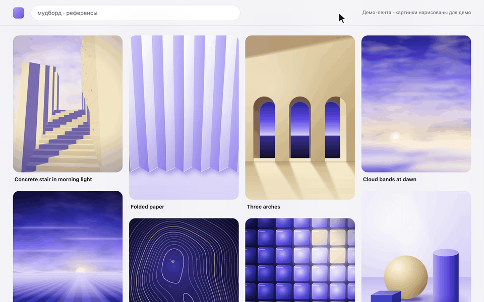
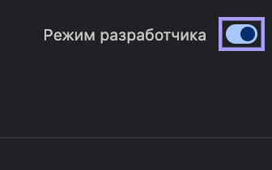
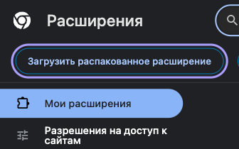
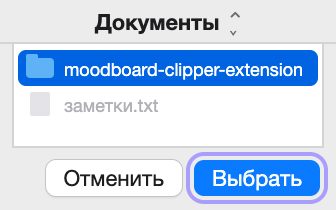
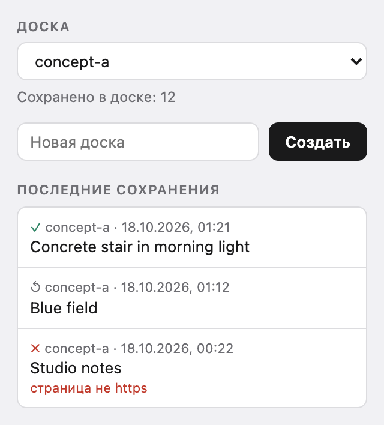

# Moodboard Clipper

Расширение для Chrome и других браузеров на Chromium. Сохраняет картинки из Pinterest, Cosmos и с любых страниц в папку на компьютере: у каждой доски своя папка, рядом с каждой картинкой карточка — откуда она, кто автор (если страница его показывает) и когда сохранена.

**[Скачать](https://github.com/georgespelllens/moodboard-clipper/releases/latest/download/moodboard-clipper-extension.zip)** · [Как установить](#установка) · [Сайт](https://georgespelllens.github.io/moodboard-clipper/ru/) · [In English](README.md)

## Установка

На Mac, Windows и Linux установка одинаковая.

1. Скачайте [`moodboard-clipper-extension.zip`](https://github.com/georgespelllens/moodboard-clipper/releases/latest/download/moodboard-clipper-extension.zip) и распакуйте: на Mac — двойным щелчком, в Windows — правый клик → **«Извлечь все»**.
2. Перенесите папку `moodboard-clipper-extension` туда, где она будет жить, например в «Документы». Браузер загружает расширение из этой папки при каждом запуске, поэтому не удаляйте и не переименовывайте её.
3. Откройте `chrome://extensions` (Яндекс Браузер: `browser://extensions`) и включите **«Режим разработчика»**. Адрес вставьте в адресную строку: по ссылке такие страницы не открываются.
4. Нажмите **«Загрузить распакованное расширение»**.
5. Выберите папку `moodboard-clipper-extension`.

| 3. Включите «Режим разработчика» | 4. Нажмите «Загрузить распакованное расширение» | 5. Выберите папку |
|---|---|---|
|  |  |  |

Появится карточка Moodboard Clipper. Закрепите значок расширения на панели, чтобы выбирать доски.

Проверить скачанный файл: положите рядом [`SHA256SUMS.txt`](https://github.com/georgespelllens/moodboard-clipper/releases/latest/download/SHA256SUMS.txt) и выполните в этой папке `shasum -a 256 -c SHA256SUMS.txt` на Mac или `sha256sum -c SHA256SUMS.txt` в Linux. В Windows откройте PowerShell в папке с архивом (в Проводнике введите `powershell` в адресной строке и нажмите Enter), выполните `(Get-FileHash moodboard-clipper-extension.zip).Hash.ToLower()` и сравните ответ со строкой архива в `SHA256SUMS.txt`.

Другие браузеры, Linux, обновление и удаление — [docs/INSTALL.md](docs/INSTALL.md) (на английском).

## Как пользоваться

- **Pinterest и Cosmos:** наведите курсор на картинку и нажмите ＋ в углу. Когда картинка сохранится, ＋ сменится на ✓. Если она уже была в этой доске, второй раз она не скачается, а при наведении на ✓ появится подсказка «уже в доске».
- **Любая страница:** правый клик по картинке → **«В мудборд»**. Работает и там, где сайт кладёт поверх картинки ссылку.
- **Behance:** картинки проекта закрыты пустым слоем, поэтому «В мудборд» стоит в меню страницы: правый клик по картинке, и расширение возьмёт ту, что под курсором.
- **Доски:** иконка расширения открывает выбор и создание доски и последние 10 сохранений. Без выбора картинки идут в `unsorted`.

<picture>
  <source media="(prefers-color-scheme: dark)" srcset="site/assets/media/popup-ru-dark.png">
  
</picture>

Файлы ложатся в `Загрузки/moodboard-inbox/<доска>/` или в [свою папку](#своя-папка). Из Pinterest и Cosmos приходит оригинал, если сайт его отдаёт; если нет, берётся самая большая копия, до которой расширение дотянулось (какая именно, написано в карточке). С других страниц приходит картинка в том виде, в каком её показывает страница. В карточке `<id>.json` — страница, адрес картинки, автор, если страница его показывает, и время. Поля карточки описаны в [docs/FORMAT.md](docs/FORMAT.md) (на английском).

## Своя папка

По умолчанию файлы кладёт в `Загрузки/moodboard-inbox/<доска>/` загрузчик браузера. Чтобы сохранять в свою папку:

1. Нажмите на иконку расширения. Строка вверху окна показывает, куда идут сохранения; нажмите **«Своя папка…»**.
2. На открывшейся странице нажмите **«Выбрать папку»** или перетащите папку на страницу. Chrome не даёт выбрать саму папку «Загрузки», поэтому выберите папку внутри неё, например `Загрузки/moodboard-inbox`: уже лежащие там доски останутся на месте.
3. Закройте эту вкладку, снова откройте окно расширения и нажмите **«Подключить папку»**.

Каждая доска станет подпапкой выбранной папки, а картинку и её карточку расширение запишет туда само. Поэтому настройка браузера «Перед скачиванием спрашивать, куда сохранить файл» больше не мешает, а обычные скачивания по-прежнему будут спрашивать.

После каждого запуска браузера (и после того, как вы закроете вкладку из шага 2) расширению нужен ещё один щелчок по **«Подключить папку»** в его окне. Пока его нет, на иконке стоит `!`, а сохранения кончаются словами «папка не подключена».

Картинке с сайта, который не Pinterest, Cosmos и Behance (правый клик → **«В мудборд»**), может понадобиться доступ к этому сайту. Тогда сохранение кончается ✗, а в строке последних сохранений появляется **«Разрешить на всех сайтах»**: необязательное разрешение, которое браузер спрашивает только по этому щелчку.

Чтобы вернуться в «Загрузки», нажмите **«Изменить»** в окне расширения, а на открывшейся странице — **«Снова сохранять в Загрузки»**.

Работает в браузерах на Chromium, где есть File System Access; подключить папку одним щелчком в окне расширения можно в Chrome 143 и новее. Если страница выбора папки пишет, что браузер не умеет сохранять в выбранную папку, сохранения остаются в «Загрузках».

## Приватность

Сервера и аккаунта нет, и в расширении нет аналитики: картинки и список досок остаются на компьютере. Расширение просит доступ к загрузкам, к меню правого клика и к Pinterest, Cosmos и Behance, а к другим сайтам — только если вы нажмёте «Разрешить на всех сайтах»; зачем каждое разрешение и какие запросы оно делает, написано в [docs/PRIVACY.md](docs/PRIVACY.md) (на английском).

## Обновление

Новая версия ставится поверх старой. Распакуйте новый архив и положите папку на место прежней — с тем же именем и в то же место (Finder и Проводник предложат заменить). Затем нажмите стрелку обновления на карточке Moodboard Clipper и перезагрузите открытые вкладки Pinterest, Cosmos и Behance. Если загрузить папку из другого места, браузер поставит расширение заново, без списка досок, выбранной доски, счётчиков, последних сохранений и данных для проверки повторов; картинки в `Загрузки/moodboard-inbox` останутся. Расширение само обновления не проверяет: новые версии появляются на странице [Releases](https://github.com/georgespelllens/moodboard-clipper/releases).

## Ограничения

- Только Chrome и другие браузеры на Chromium: Firefox и Safari нет.
- Расширения пока нет в Chrome Web Store, браузер загружает его в режиме разработчика.
- Если в браузере включено «Перед скачиванием спрашивать, куда сохранить файл», в режиме «Загрузки» он спрашивает об этом при каждом сохранении, и расширение не может это отключить. Выберите в окне расширения **«Своя папка…»** ([выше](#своя-папка)): тогда расширение пишет файлы само, и настройка перестаёт влиять. Или выключите её в разделе «Скачанные файлы» (в Chrome — `chrome://settings/downloads`).
- Название пина чистится под русский интерфейс Pinterest. На других языках в названии может остаться обёртка со страницы.

## Сохранить не значит получить право

Картинка в вашей папке по-прежнему принадлежит автору. Прежде чем публиковать или продавать то, что из неё сделано, проверьте условия автора.

## Сборка из исходников

- `extension/` загружается в браузер как есть, без сборки. Тесты: `cd extension && node --test test/lib/*.test.js test/scripts/*.test.js && node test/worker/worker-harness.mjs`.
- `scripts/package-extension.sh` собирает `dist/extension/` и zip, в котором лежит содержимое этой папки.

## Чужие идеи

Идеи, без кода: [extesy/hoverzoom](https://github.com/extesy/hoverzoom) (MIT), [qsniyg/maxurl](https://github.com/qsniyg/maxurl) (Apache-2.0), [thetejasagrawal/Pinterest-LocalBoard](https://github.com/thetejasagrawal/Pinterest-LocalBoard) (MIT), [mrmayeen/moodboard-extension](https://github.com/mrmayeen/moodboard-extension) (MIT) и [Angel2mp3/Pinterest-Power-Menu](https://github.com/Angel2mp3/Pinterest-Power-Menu) (MIT).

## Лицензия

Код и картинки демо — [MIT](LICENSE), © SPELLLENS. Картинки в `demo/works/` (они же в демо-GIF и на обложке) рисует [`demo/draw-works.mjs`](demo/draw-works.mjs). Шрифт сайта Onest — под SIL Open Font License ([`site/assets/fonts/OFL.txt`](site/assets/fonts/OFL.txt)). Названия сайтов и браузеров, упомянутых здесь, — товарные знаки их владельцев; проект с ними не связан.

<picture>
  <source media="(prefers-color-scheme: dark)" srcset="site/assets/media/wordmark-white.svg">
  
</picture>
